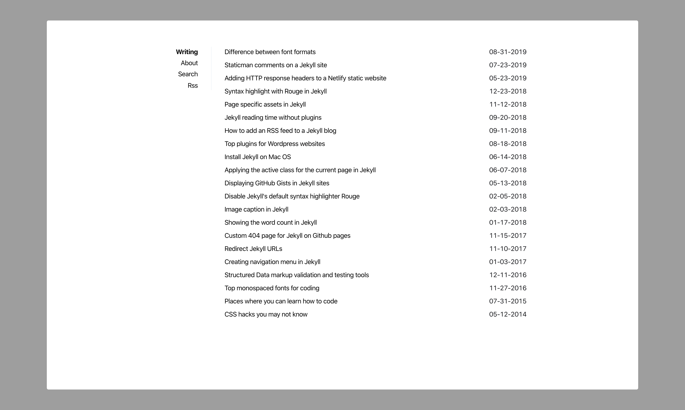

> Historical theme reference. The website now builds from `stream/`. Restore commit `c54852f` in a separate checkout if you need the former Ruby/Jekyll build and its dependency manifests.

# Sidey

Sidey is a simple and minimalistic jekyll blogging theme.

### Features

- Responsive design
- Inline CSS
- Anchor headings
- Search
- Tags & tag pages
- Security headers (for Netlify hosting)
- 404 page
- Compressed CSS and HTML
- 100/100 score on Lighthouse, Page Speed Insights & Webpagetest
- Robots.txt
- Atom & Json feeds
- Sass
- Seo optimized (Twitter cards, Facebook Open Graph, Schema.org)
- Ultra fast (Only ~5kb of CSS)
- Sidebar navigation

### Screenshot

