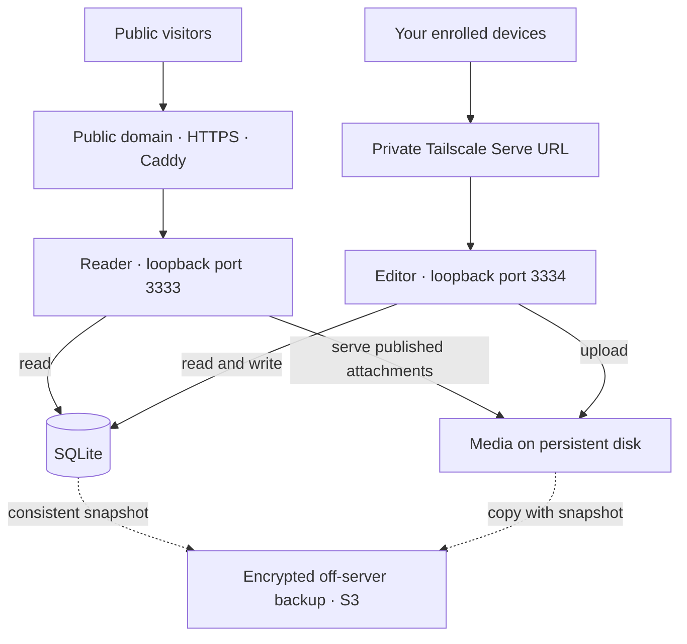

# Deployment plan

Historical alternative. Superseded by [Obsidian → GitHub Pages](deployment-plan.md). Retained to explain the earlier server proposal; none of it was deployed.

Prepared for ridge on 27 October 2026. This is a proposal: no infrastructure, account, DNS, tailnet, remote repository or production data has been changed.

Research follow-up: [the reference architectures](reference-architectures.md) compares Maggie, Eric, Rasmus and Spencer's documented publishing systems. Evaluate a static public export before provisioning. The server-based reader below remains the smallest-change deployment path; no migration or hosting choice has been applied.

## Recommended first deployment

Run one always-on Linux server with the existing Node app, SQLite and media on persistent local disk. Put Caddy in front of the public reader and Tailscale Serve in front of the private editor. Send encrypted backups to a private S3 bucket. Add CloudFront after the first deployment if global delivery or learning the CDN is a priority. Keep Supabase as a future option.

SQLite is a production database. For this single-author site, a separate database server adds little: the database and application can remain on the same machine. SQLite's own guidance supports this kind of website and advises reconsidering the choice when multiple servers or many concurrent writers are needed. Keep the live database on local disk, not a shared network filesystem. [SQLite deployment guidance](https://sqlite.org/whentouse.html).



Caddy, Serve, the app and its live data run on the same server. The backup bucket is outside that server. Your laptop can sleep while the public site and private editor remain available.

## Where the preferred technologies fit

| Technology | First deployment | Reason |
| --- | --- | --- |
| Tailscale | Use for editor access and server administration | Existing device identity supplies authentication; no separate website login |
| SQLite | Keep | Already implemented, easy to move and back up, appropriate for one writer |
| Supabase | Defer | Would require replacing the SQLite store; useful later for several application servers, shared database access or other Postgres features |
| CloudFront | Optional second phase | Caches public files near readers; the Node server still supplies the origin content |
| S3 | Use as a private backup destination | Separates recovery copies from the running server; serving uploads from it can be a later change |

Supabase would also need its own access policies and operational choices. It would not automatically replace the private editor boundary. Its free-plan availability rules include possible pausing after low activity, so a free project should not be assumed to be an unattended, always-on replacement. [Supabase production guidance](https://supabase.com/docs/guides/deployment/going-into-prod).

## 1. Agree on the deployment inputs

Choose the public domain, its existing DNS provider, the server region, the exact Tailscale owner identity, and a monthly budget. Keep the current DNS provider unless there is a reason to move it.

My concrete AWS starting point is a Linux Lightsail instance with 2 GB RAM and persistent disk. The current public-IPv4 bundle lists 2 GB RAM, 60 GB SSD and a US$12/month base price. Confirm regional allowances, tax and the final quote before buying. Backups, domain registration and additional usage are separate. A Sydney region is a sensible candidate given your location; confirm availability and the quote at provisioning. [Lightsail pricing](https://aws.amazon.com/lightsail/pricing/).

This is a starting size to validate with uploads, not a capacity guarantee. Photos and audio will determine storage growth sooner than short text entries.

**Result:** an agreed domain, provider/region, owner identity, backup destination and budget. No purchase occurs while these are still proposals.

## 2. Prepare a reproducible release locally

Create an approved source commit and a private Git remote. Keep `data/`, `.local/demo/`, credentials and backups outside Git. CI runs `npm ci`, `npm run check` and `npm test` on Linux with a pinned, supported Node 24 patch release. Install dependencies on the target platform; do not copy the Mac's `node_modules`. [Node release guidance](https://nodejs.org/en/about/previous-releases).

Before launch, prepare these small operational changes:

- A release script that installs into a new directory, validates it, switches the active release and checks the public homepage. It must never overwrite the live data directory.
- Explicit, versioned schema migrations and a refusal to open a newer unsupported schema. The current initializer sets `user_version` to 1 unconditionally; that should not become the migration strategy.
- Streaming media responses with byte-range support. The current server reads an entire attachment into RAM, including for a range request. Streaming avoids multiplying that memory use when several people play audio.
- A scheduled backup wrapper with remote upload, retention, validation and failure reporting. The existing snapshot command is the base, not the whole backup system.

Use the existing Caddy and systemd examples as starting points. Resolve their paths for the release layout rather than installing them unchanged.

**Result:** a reviewed source release, passing Linux checks, deployment/rollback commands and a recovery runbook. No cloud rollout yet.

## 3. Provision the server and separate code from data

Use a maintained Linux LTS image, attach a stable public address, install the selected Node runtime, Caddy and Tailscale, and run the app as a dedicated service user under systemd.

Proposed layout:

```text
/opt/ridge/releases/<commit>/     immutable application releases
/opt/ridge/current               active release symlink
/var/lib/ridge/ridge.sqlite      live database
/var/lib/ridge/media/            live uploads
/etc/ridge.env                  restricted runtime configuration
```

Public network access is HTTP/HTTPS to Caddy. Both Node listeners remain on loopback. Administration uses the tailnet, with provider-console recovery available if tailnet access fails. Configure OS updates, service restart after reboot, bounded logs and disk-space reporting.

Caddy proxies only to port 3333. It can obtain and renew the public HTTPS certificate once DNS and network reachability are correct. [Caddy automatic HTTPS](https://caddyserver.com/docs/automatic-https).

**Result:** a running candidate whose data survives code releases and reboots. Test its reader through a private preview before changing public DNS.

## 4. Verify private posting on the real tailnet

Use the existing Tailscale mode with the exact HTTPS Serve origin and exact owner login. Review the tailnet's existing rules as well as the new server's grants; adding a narrow rule does not remove a broader existing allow rule.

Your phone or laptop connects to Tailscale, opens the private Serve address, and posts without an extra website password. A visitor opens the public domain from any ordinary browser.

Serve supplies and sanitizes user identity headers; the app enforces the owner check. User headers are absent for requests from tagged client devices, so test with your normal user-owned phone and laptop. Tagging the server itself is a separate choice. [Serve identity and trust model](https://tailscale.com/docs/features/tailscale-serve#identity-headers).

Acceptance checks:

- Your phone and laptop can publish, edit, upload, record audio, archive and restore over private HTTPS.
- Another tailnet identity is refused. A device outside the tailnet cannot reach the editor.
- Direct access to Node ports is unavailable remotely. Public write requests fail even with forged identity headers.
- The public page contains no composer, private transcript-editing controls or CSRF token.
- A reboot restores both intended entrances without widening access.

The repository tests currently simulate the proxy identity. This real Serve test is still required before launch.

## 5. Back up and prove a restore before launch

Proposed recovery targets: at most one hour of lost posts and a manually rebuilt service within two hours. These are targets to measure, not availability promises.

Each hour, use the existing SQLite backup API to create a consistent database snapshot, copy its media, validate that referenced files exist, and upload the result using Restic to a private S3 backup repository. Keep a stable backup grouping so retention works across snapshots. Retain 24 hourly, 7 daily, 4 weekly and 6 monthly recovery points initially. Clean staging copies only after a successful upload.

The current app retains committed media files rather than purging them, which makes snapshot-then-copy workable. Any later physical deletion feature must coordinate with backups. Do not copy a live SQLite file with a plain file copy and assume the WAL has been captured.

Restic supports encrypted repositories and S3 destinations. Store its recovery password separately in your password manager, and scope server credentials to the backup destination. [Restic repository and S3 documentation](https://restic.readthedocs.io/en/stable/030_preparing_a_new_repo.html).

Restore a backup into an isolated directory or replacement server. Verify SQLite integrity, attachment references, several photos, audio playback and archived-post access. Record the matching application/schema version and elapsed restore time. Repeat a restore periodically and before risky schema changes.

**Result:** evidence that losing the original server is recoverable. A provider snapshot or a Git commit is not the sole recovery copy.

## 6. Launch and operate

Use only approved personal content for production; keep the existing sample database on its separate preview. Set the canonical public origin, verify RSS/permalinks, choose the canonical hostname, then point DNS at the public server. Check HTTPS from a device outside the tailnet and posting from your phone inside it.

Monitor the public homepage, not only the current `/health` response: the homepage also exercises database reads and rendering. Report failed backups, low disk space, sustained errors and service failures. Configure provider billing alerts. Maintain a regular patch/release cadence.

For each subsequent release:

1. Run CI and record the source commit and schema version.
2. Create and verify a fresh backup before a schema change.
3. Install the new release alongside the old one and apply reviewed migrations.
4. Switch the active release, restart, refresh the editor and check public rendering plus private access.
5. Roll code back on failure only if the schema is compatible. Restore data only through a deliberate recovery step, since a restore can discard newer posts.

A short restart outage is acceptable in this first design. It is one server, with recovery procedures rather than automatic high availability.

## 7. Add CloudFront deliberately

CloudFront is a delivery/cache layer, not a replacement for the running Node application or its database. It can use the VPS's HTTPS reader as a custom origin. [CloudFront architecture](https://docs.aws.amazon.com/AmazonCloudFront/latest/DeveloperGuide/Introduction.html).

If included, provision the public hostname certificate in ACM's required `us-east-1` region, keep HTTPS to the origin, and configure the origin hostname/Host header to match Caddy. The private Serve URL never goes through CloudFront. [CloudFront certificate requirements](https://docs.aws.amazon.com/AmazonCloudFront/latest/DeveloperGuide/cnames-and-https-requirements.html).

Initial cache behaviours:

| Path | Policy |
| --- | --- |
| `/assets/*` | Cache public assets with the app's current lifetime; include `v` in the cache key |
| `/`, `/p/*`, `/api/*`, `/feed.xml`, `/media/*` | Disable caching initially; preserve required query parameters such as `tag` and `before` |
| Errors | Avoid lingering cached 403/404 responses during archive/restore and launch |
| Editor | No route or origin mapping to it |

Allow only public reading methods. Do not forward private identity headers or use the editor as an origin. Set minimum TTL to zero where origin cache directives must be honoured: a positive CloudFront minimum TTL can override `no-cache` and `no-store`. [Cache-policy semantics](https://docs.aws.amazon.com/AmazonCloudFront/latest/DeveloperGuide/cache-key-understand-cache-policy.html), [cache keys](https://docs.aws.amazon.com/AmazonCloudFront/latest/DeveloperGuide/controlling-the-cache-key.html).

Caching images/audio can follow once edits and archive operations have an explicit invalidation policy. Otherwise a CDN could continue serving an archived attachment. Cached assets improve delivery, but this does not make uncached feed pages survive a server failure.

CloudFront currently lists a $0/month Free plan, alongside paid plans. Review its allowances and eligibility when provisioning; the origin, domain and backup costs remain separate. [CloudFront pricing](https://aws.amazon.com/cloudfront/pricing/).

## Alternative if public uptime becomes the priority

A later static publishing pipeline could export the public pages, tag filters, pagination, backlinks, RSS and approved media into a private S3 origin served through CloudFront using origin access control. The Tailscale editor would retain SQLite. [S3 origin access control](https://docs.aws.amazon.com/AmazonCloudFront/latest/DeveloperGuide/private-content-restricting-access-to-s3.html).

That requires a reliable exporter, publish retries, release consistency and deletion/invalidation handling. It is a real architectural change, not a deployment setting. It would let the public site survive the writer being offline, while writing would still require an available editor machine. Choose it if that benefit outweighs the additional pipeline; it is not required for the first launch.
