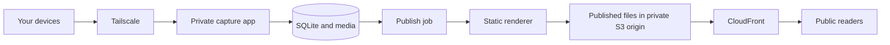

# What the reference sites teach us about publishing

Follow-up decision: the current implementation uses [Obsidian → GitHub Pages](deployment-plan.md), extending the local-editor/static-output pattern below. The earlier server and S3/CloudFront options remain architectural references.

Research checked on 27 October 2026. Findings below distinguish author documentation and source configuration from proposals for ridge. No application or hosting changes were made.

## Verified examples

| Reference | Documented construction and delivery | Useful lesson |
| --- | --- | --- |
| Maggie Appleton | Astro, MDX files and Vercel. Her repository documents local production builds and prebuilt deployments; videos use R2. | Use an established content renderer and reusable components; separate media processing from page requests. |
| Eric Zhang | SvelteKit and Tailwind on GitHub Pages; the configuration explicitly uses `adapter-static`. | A framework-based, interactive-looking site can still ship as files without a public Node runtime. |
| Rasmus Andersson / rsms | His About page describes HTML and Markdown processed by Jekyll, hosted by GitHub and distributed by Cloudflare. | Strong typography and browser experiments do not require a dynamic content backend for readers. |
| Spencer Chang's published v3 / Fits Stream | An older public repository documents Hugo and GitHub Pages, plus an Apple Photos export into images and JSON. | Personal, frequently updated collections can be generated from a convenient capture workflow. |

Sources: [Maggie's colophon](https://maggieappleton.com/colophon), [her repository](https://github.com/MaggieAppleton/maggieappleton.com-V3), [Eric's README](https://github.com/ekzhang/ekzhang.github.io), [Eric's static adapter configuration](https://github.com/ekzhang/ekzhang.github.io/blob/main/svelte.config.js), [Rasmus's About page](https://rsms.me/about/), [Spencer's v3 README](https://github.com/spencerc99/spencerc99.github.io/blob/main/README.md).

Spencer's repository was last pushed in 2024 and describes the earlier domain. This is evidence for that documented implementation, not proof of the entire current `spencer.place` stack. His [2023 account of home-cooked apps](https://news.spencer.place/p/ti-07-my-homecooked-apps) also describes a separate status API feeding the website, illustrating how static presentation and small live services can coexist.

Wonger's [Nuggets](https://wonger.dev/nuggets) discusses a Vim/HTML writing mechanism and custom Perl feed generators. His public older blog repository contains Jekyll configuration, but I could not establish that it backs the current Nuggets feed. I have not assigned the current feed a hosting provider. I also could not verify current deployment details for Winnie Lim or Untested from accessible primary material.

## An unusually relevant separation

Maggie's public repository includes a [local writing editor](https://github.com/MaggieAppleton/maggieappleton.com-V3/blob/main/docs/local-writing-editor/README.md). Its documentation says that editing and file-writing APIs exist only in the development server and are omitted from production builds. It edits existing MDX prose; it is not a complete mobile photo/audio capture system.

That is a useful architectural precedent: authoring can be a private application while the public site is a published result. We can adopt that separation without adopting her editing workflow or copying her personal theme.

## How this differs from our current app

The current app renders each public page when a request arrives. Its private composer stores posts and media in SQLite and files on the same machine. This is a valid, relatively direct first deployment.

The reference pattern moves public rendering to publication time. A publish worker produces HTML, RSS, JSON and media assets; ordinary static hosting or a CDN serves those results. Readers need neither the editor nor a database connection.

For ridge, a possible architecture is:

The flowers, audio player, mathematics and future browser-side visualisations can remain interactive. Static delivery describes how the HTML and assets are served, not whether the page moves or responds to a pointer. Our existing garden animation already runs entirely in the browser.

## What to build on

Astro is the strongest framework candidate for the public side if we choose to adopt one. Its content collections provide structured content loading and validation, while its component model supports content-focused pages with selective client-side interaction. [Content collections](https://docs.astro.build/en/guides/content-collections/), [Astro components](https://docs.astro.build/en/basics/astro-components/).

We would retain ridge's HTML/CSS direction, browser animation, attachment model and private composer. Daily entries could stay plain Markdown plus structured metadata and media manifests, with SQLite as the authoritative authoring store. Polished essays could later use separately authored MDX components. Choosing a static renderer does not require typing a Git commit or editing a source file for each run, coffee or voice note.

The smallest proof of concept can use our existing rendering functions to export one complete public snapshot. That lets us evaluate the publishing boundary before committing to an Astro migration. Astro becomes worthwhile if its routing, collections and component tooling remove enough ongoing custom maintenance.

Maggie's repository is useful to study, but its README asks people to develop their own gardens rather than fork her personal design wholesale. Any actual code reuse also needs a license check. Prefer the framework's supported starting point and adapt our own interface.

## Work that static hosting would add

This is not a hosting switch for the current app. A reliable publisher must:

- Save capture data immediately and show separate publication status, errors and retry handling.
- Serialize or coalesce publish jobs so an older build cannot overwrite a newer post.
- Export only public posts and their permitted attachments, excluding archived records, editor controls, private configuration and SQLite files.
- Generate permalinks, RSS, backlinks, tag views and pagination. Our current query-based tag/pagination URLs need static equivalents or an explicit rewrite design.
- Preserve useful JSON outputs if future feed filters or artefacts need data.
- Publish a validated, consistent release and handle partial-upload failures. S3 uploads across multiple keys are not an atomic site deployment by themselves.
- Remove withdrawn pages/media and invalidate affected CDN copies. Restoring a post must also clear stale error responses.
- Keep database/media backups independently of published output.

Image processing should happen once per upload and be reused across builds. A daily capture stream needs a much shorter publishing loop than an occasional essay site.

If the private editor runs on a laptop, that laptop must be available to receive phone posts and publish them. An always-on private writer still makes sense for ridge even if the public reader moves entirely to S3/CloudFront.

## Effect on the deployment proposal

The existing [deployment plan](deployment-plan.md) remains the shortest path from the running code: one server, with separate public and private listeners. This research makes a static public reader a serious first-launch option to evaluate before provisioning, rather than only a distant enhancement.

My preferred long-term separation is a private capture application plus a published public site. First validate a static snapshot from our existing renderer; then choose whether to retain that small exporter or adopt Astro for the public rendering layer. This preserves the low-friction stream while learning from the reference sites' simpler public delivery.
